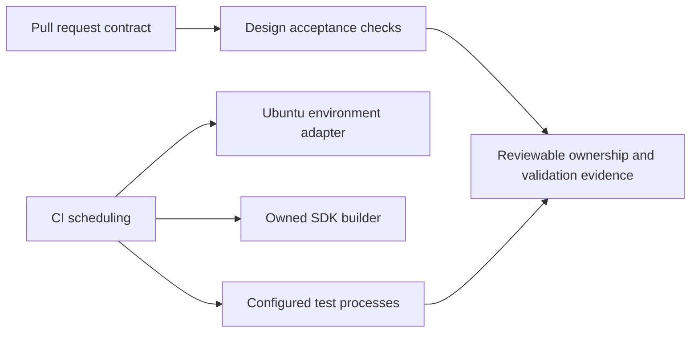

# GitHub integration

This folder owns provider-specific CI scheduling, environment adapters and the PR review interface. Player abstractions and SDK construction stay in their source/tool owners.

[The PR template](PULL_REQUEST_TEMPLATE.md) records responsibility, dependencies, lifetime/error behavior, removed code and validation. These fields make a patch reviewable; they do not replace semantic review. Main's squash commit retains that review body and follows the [commit naming convention](../CONTRIBUTING.md#commit-names).

[The environment action](actions/setup-build/README.md) installs selected host dependencies and restores caches. [The Qt SDK owner](../scripts/qt/windows/README.md) constructs the x86-64 target SDK. The workflow consumes those interfaces, transports artifacts and runs all supported qualification modes. Main runs complete to warm shared caches; superseded PR runs may be cancelled.

`workflows/ci.yml` is the entry point for pushes and pull requests. It owns triggers and cancellation, then calls five focused workflows:

| Workflow | Responsibility |
| --- | --- |
| [checks.yml](workflows/checks.yml) | Formatting and developer-tool tests. |
| [linux.yml](workflows/linux.yml) | Debug/ASan tests, the headless build and the Linux release build. |
| [tsan.yml](workflows/tsan.yml) | The instrumented Qt Core runtime and repeated native TSan tests. |
| [windows.yml](workflows/windows.yml) | Static x64 Qt, cross-compilation, packaging and native Windows journeys. |
| [coverage.yml](workflows/coverage.yml) | Full coverage measurement, reports and main's Pages publication. |

These workflows are called directly; there is no second dispatch layer. Windows packaging and execution stay together so their artifact dependency is explicit. Coverage publication stays with measurement. Ordinary Linux jobs have no Qt SDK construction or sanitizer-runtime conditionals. GUI failure artifacts use one job-owned artifact directory, independent of preset build-directory names.

[performance.yml](workflows/performance.yml) is a manual measurement workflow. It prepares dependencies, records build timings and runs the native CMake benchmark target. It does not add timing thresholds or run on every pull request.
