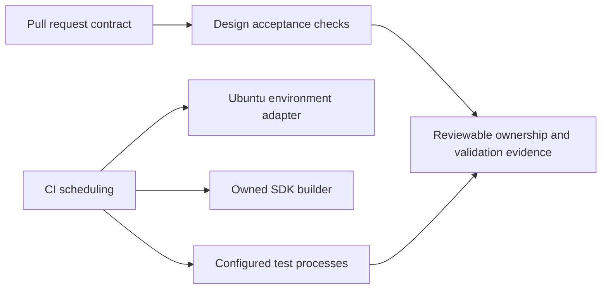

# GitHub integration

This folder owns provider-specific CI scheduling, environment adapters and the PR review interface. Player abstractions and SDK construction stay in their source/tool owners.

[The PR template](PULL_REQUEST_TEMPLATE.md) records responsibility, dependencies, lifetime/error behavior, removed code and validation. These fields make a patch reviewable; they do not replace semantic review. Main's squash commit retains that review body and follows the [commit naming convention](../CONTRIBUTING.md#commit-names).

[The environment action](actions/setup-build/README.md) installs selected host dependencies and restores caches. [The Qt SDK owner](../scripts/qt/windows/README.md) constructs the x86-64 target SDK. The workflow consumes those interfaces, transports artifacts and runs all supported qualification modes. Main runs complete to warm shared caches; superseded PR runs may be cancelled.
