# Ubuntu build environment action

This GitHub adapter restores dependency/compiler caches and installs the requested Ubuntu host tools. It does not configure the player, select a GUI implementation, build an SDK or execute tests.

```mermaid
flowchart LR
  Inputs[Build identity, paths and package requirements] --> Cache[Restore existing caches]
  Cache --> Resolve[Resolve current APT transaction]
  Resolve --> Archives[Restore package archives]
  Archives --> Packages[APT verifies and installs required packages]
  Packages --> Save[Save successful default-branch archive cache]
  Save --> Environment[C and C++ compiler launcher environment]
  Environment --> Build[Calling workflow's build]
```

`name` partitions caches, `build-dir` identifies actual dependency output, `packages` adds package requirements, and `qt` controls host Qt tools. Headless builds pass `qt: false`. The Windows workflow requests only the x86-64 POSIX MinGW compiler package, whose dependencies supply its matching C compiler/binutils; the all-architecture `mingw-w64` metapackage is unnecessary.

APT resolves the requested packages before restoring archives. The cache key hashes its resolved archive filenames, sizes and checksums, independent of the download mirror. This action installs packages directly with `apt-get`; there is no package manifest or Python resolver. Only successful default-branch installations save caches, immediately before compilation; pull requests reuse those caches. The private archive directory is `.cache/ubuntu-packages`, separate from system APT directories. Cache transport includes only its top-level `.deb` files, excluding APT locks and partial downloads. It is not the SDK cache.

APT verifies restored archives and installs required dependencies, including Qt platform plugins for GUI checks, with optional recommendations disabled. Operations retry failed transfers and use bounded inactivity timeouts. Additional package names are passed as array arguments, not evaluated shell text. Ccache is made available to both C and C++ CMake compilations. A restored cache is reuse evidence, not proof that a build or test passed.

SDK construction and cache identity belong to [the Qt SDK owner](../../../scripts/qt/windows/README.md). The workflow owns scheduling and artifact transport. Changes to those responsibilities belong with their owners rather than inside this environment adapter.

The host package list lives in this action: ccache, optional host Qt development tools and caller-supplied extra packages.
