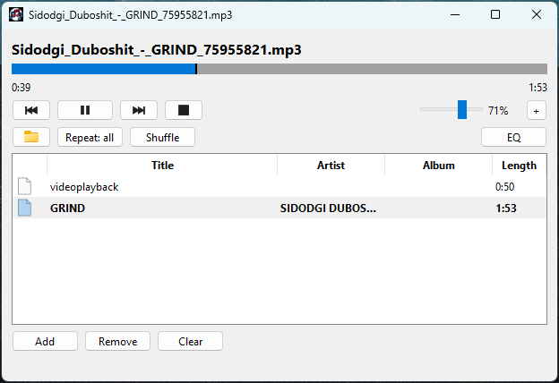

[](https://vokerlee.github.io/wiola-player/coverage/)

# Wiola Player

Wiola is a small desktop music player with a playlist, track metadata and artwork, seeking,
repeat/shuffle modes, volume control, and a ten-band equalizer. On Windows, the player is one
executable: no installer and no DLLs to place beside it.



## Run it on Windows

1. Download
   [`wiola-player.exe`](https://github.com/Vokerlee/wiola-player/releases/latest/download/wiola-player.exe)
   from the [latest release](https://github.com/Vokerlee/wiola-player/releases/latest).
2. Double-click it.
3. Press **Open** and choose one or more audio files.

There is no setup. Delete the executable when you are done with it.

## Run it on Linux

There is no package yet, so build it from source. [CONTRIBUTING.md](CONTRIBUTING.md) describes the
required tools, build presets, tests, coverage, and formatting checks for Linux and Windows.

## Audio support

Wiola supports these audio formats:

- MP2 and MP3;
- AAC-LC in MP4/M4A and ADTS;
- FLAC and ALAC;
- Vorbis and Opus in Ogg, Matroska, and WebM;
- WavPack, Monkey's Audio, TTA, and WMAv2;
- PCM in WAV, AIFF/AIFC, AU, CAF, Wave64, and RF64 containers.

Mono, stereo, and 5.1-side channel layouts are supported. Unsupported layouts are not silently
downmixed. A matching filename extension alone does not guarantee that a particular file is
playable.

## Using the player

- **Open** replaces the current playlist with the selected files; **Add** appends to it.
- **Remove** takes the selected entry out of the playlist, and **Clear** empties it.
- **Play/Pause/Resume**, **Stop**, and the previous/next buttons control playback.
- Click the position bar to seek through the current track.
- **Repeat** cycles through the repeat modes, and **Shuffle** changes the playback order.
- The volume slider controls gain; **+** allows amplification up to 140%.
- **EQ** opens the ten-band equalizer, with up to ±12 dB adjustment per band.
- Track tags and attached artwork appear in the playlist when available.

The playlist, volume, and equalizer settings are restored for the next run. The window remains
responsive while tracks and their metadata are opened.

## Command-line flags

Normal invocation opens the GUI. Wiola does not provide a separate headless playback mode, but these
flags work without creating the application window:

```sh
wiola-player --help
wiola-player --version
```

The short forms are `-h` and `-v`.

## Contributing

Start with [CONTRIBUTING.md](CONTRIBUTING.md) for build and test instructions. Developers working on
audio formats can continue with the [codec guide](src/codec/README.md).

## License

GPL-3.0. See [LICENSE](LICENSE).
