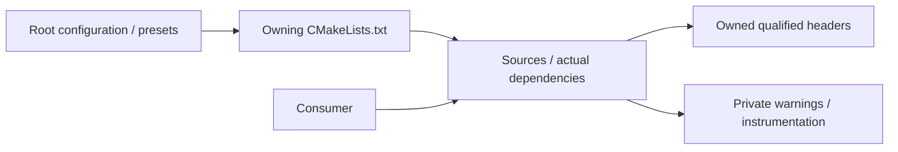

# Build configuration

The root project selects components, external dependencies and build controls. Each source owner declares its own targets and actual public/private dependencies in its CMakeLists.txt. Public clients link those targets.

`headers.cmake` keeps authored headers with their implementation. Target-owned generated forwarders supply qualified includes in the build tree. Authored headers are private source entries of their owner; include paths expose the declared API. This keeps source ownership and consumer dependencies readable in CMake and its File API.

`build.cmake` supplies compiler controls and thin local library/test declarations. Internal implementation/test include access is private. Each public declaration links the targets supplying its field and signature types. The version header belongs to the executable build.

`components.cmake` selects ordinary source targets for independent core/application work. The dependency recipes prepare external SDKs only for the chosen composition. Configure presets describe toolchains and build directories; CTest and the existing LLVM reporting command provide test and coverage execution.

Top-level `BUILD_TESTING` registers the lightweight presentation and QtCore consumer checks through CTest target names. `ENABLE_UNIT_TESTS` additionally builds the GoogleTest suites. The headless preset leaves those suites disabled and runs its registered public consumer through the normal configure/build/test presets. CMake supplies executable paths to CTest.
