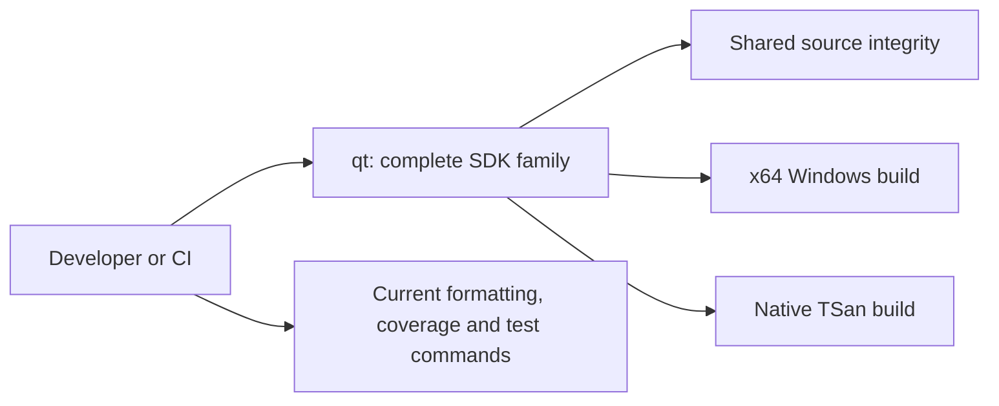

# Developer commands

Maintained commands are grouped by responsibility. Their implementation, tests, data and CLI belong together; file language does not determine ownership.

[Qt tooling](qt/README.md) is complete under `qt/`: one source provider, the x64 Windows recipe and the native instrumented Core recipe. Use their canonical commands directly; no Qt launcher or implementation lives elsewhere in this tree.

`cmake.py` resolves a named target artifact from CMake’s generated File API reply for focused coverage and the instrumented Qt recipe. Build commands use CMake directly; there is no Python build model or source/dependency inventory to maintain.

Current other commands:

- `python3 -m scripts.formatting` owns [formatting and hooks](formatting/README.md), as described in [CONTRIBUTING.md](../CONTRIBUTING.md).
- C++ tests run through CTest. Native Windows CI consumes the `wiola_desktop_tests` CMake install component and executes its GoogleTest binaries directly; fixtures and reports stay in that package.
- `cmake --build --preset linux-coverage --target coverage` builds, tests and collects LLVM reports. `python3 -m scripts.coverage --build-dir BUILD` can collect from an already-built instrumented configuration. CI owns thresholds; there is no source-owner registry or checked-in coverage baseline.

Caller-provided paths and configured target metadata determine runtime artifacts. Commands must preserve caller environments, retain original diagnostics and report failures accurately. Development tooling has the same ownership and test requirements as player code.
