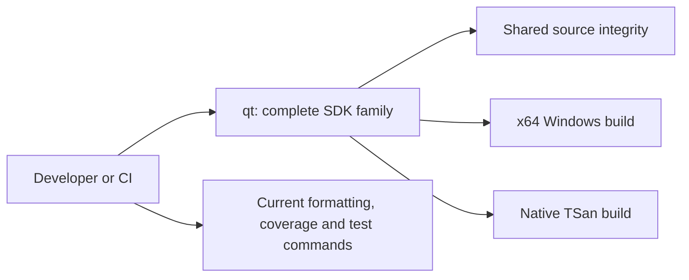

# Developer commands

Maintained commands are grouped by responsibility. Their implementation, tests, data and CLI belong together; file language does not determine ownership.

[Qt tooling](qt/README.md) is complete under `qt/`: one source provider, the x64 Windows recipe and the native instrumented Core recipe. Use their canonical commands directly; no Qt launcher or implementation lives elsewhere in this tree.

[Configured builds](build/README.md) expose one public CMake inventory/build API used by SDK, quality and test callers.

Current other commands:

- `format-cpp.sh`, `format-cmake.sh` and `install-hooks.sh` are described in [CONTRIBUTING.md](../CONTRIBUTING.md).
- `run-desktop-journeys.py` uses the [owned desktop composition](../tools/testing/desktop_checks/README.md) and [GoogleTest protocol](../tools/testing/gtest/README.md).
- `check-gui-mutations.py` uses [owned mutation qualification](../tools/testing/mutation_checks/README.md); CMake provides its actual build directory through `wiola_check_mutations`.
- `coverage.sh` runs the coverage collector; [coverage qualification](../tools/coverage/README.md) explains source scope and retained evidence.
- `test-affected.py` builds and runs explicitly selected test targets.

Caller-provided paths and configured target metadata determine runtime artifacts. Commands must preserve caller environments, retain original diagnostics and report failures accurately. Development tooling has the same ownership and test requirements as player code.
