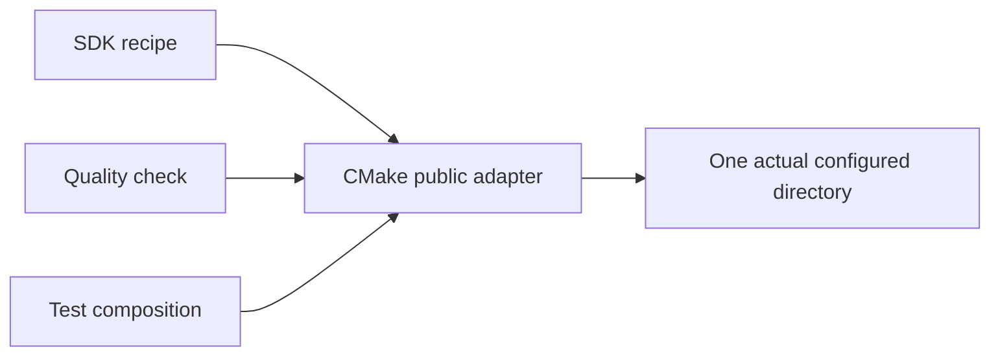

# Configured-build commands

This grouping contains developer capabilities that observe and operate on explicitly configured builds. Each child owns its complete implementation, public interface and tests. There is no player, toolkit or test-runner policy here.

[cmake](cmake/README.md) reads File API metadata, builds a named target and resolves its declared artifact. Callers provide configuration and decide what a resulting executable means.

[packages](packages/README.md) owns Ubuntu host requirements, APT resolution/verification and reusable archive identity. CI supplies explicit choices and transports caches; it does not duplicate the package recipe.

[context](context/README.md) owns the explicit portable component selection and the dependency closure consumed by root configuration.
