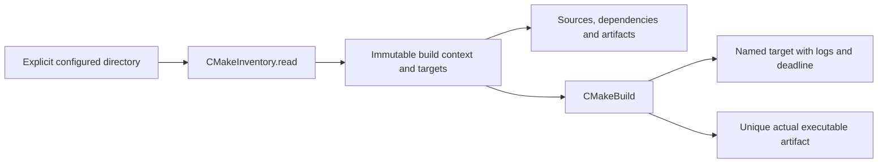

# Configured CMake adapter

This component owns observing and building one configured CMake context. Import its public API from `scripts.build.cmake`: `CMakeInventory`, `BuildTarget`, `BuildInventoryError` and `CMakeBuild`. `_inventory.py` and `_build.py` are internal implementation modules; callers do not depend on their file organization.

Call `CMakeInventory.read(directory, first_party_sources=...)` after configuration has produced a File API codemodel-v2 reply. The snapshot retains its actual build directory and source root, target identities, source/dependency membership, definitions and artifact paths. Declared first-party paths are optional caller policy; generated/external sources remain distinct. Build-tree boundaries use actual CMake cache markers rather than directory-name guesses. Unsupported or ambiguous configurations, invalid references and inconsistent target identities fail explicitly.

Construct `CMakeBuild(snapshot, jobs=..., timeout=...)`. Its directory comes from that snapshot, so metadata from one build cannot accidentally be paired with a second directory argument. A metadata-only projection without a configured directory remains useful for pure observation tests and cannot drive a build. Re-read metadata after changing configuration; a snapshot does not claim to observe later concurrent reconfiguration.

`build(name, log)` builds one configured target, retains stdout/stderr and propagates failure/timeout. Parallelism comes from an explicit value, `CMAKE_BUILD_PARALLEL_LEVEL` or available CPU affinity/count. `executable(name)` requires a unique built executable artifact from the same configuration. It never searches test/output folders or appends an OS suffix. No source mutation, configure step, test execution, SDK choice, Git inspection or GUI assumption occurs implicitly.

The complete reader, builder, [tests](tests/README.md) and public facade live here. Historical inventory IDs remain explicit parts of this one reviewed component, preserving measurement lineage without separate abstraction folders or guides. Architecture, SDK, mutation and coverage callers consume the same public API.
