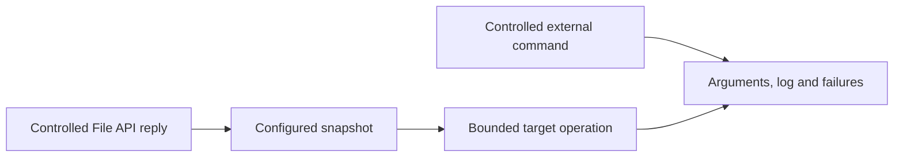

# Configured-build tests

The inventory fixtures model actual codemodel-v2 references and exercise source/generated/external classification, target/dependency/artifact identity and malformed/ambiguous replies. Snapshot tests retain the actual configured directory.

Builder fixtures put artifacts outside conventional output folders without an OS suffix. Controlled external processes verify arguments, retained logs, failures, deadlines and rejection before executing unknown targets. An observation-only snapshot cannot drive a build; callers cannot supply an independent mismatched build directory.

Run `python3 -m unittest scripts.build.cmake.tests.test_inventory scripts.build.cmake.tests.test_build`. No player build, toolkit or SDK installation is required. Actual repository/SDK inventories provide separate integration evidence through the same public facade.
