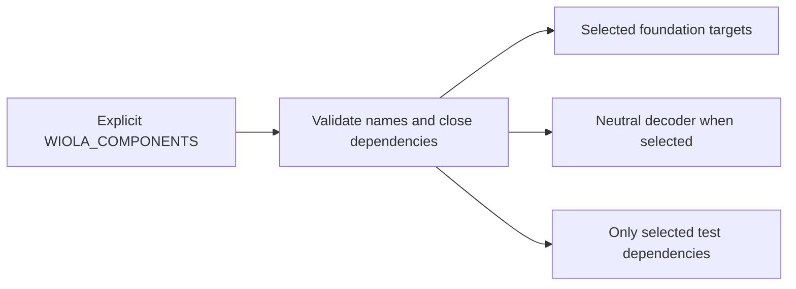

# Portable build context

This component owns the root configuration's supported portable selections and their explicit dependency closure. Product targets stay with their source components. Include select.cmake through the project entrypoint; no SDK or test runner is selected by source folder spelling or host OS.

Empty WIOLA_COMPONENTS preserves the existing full desktop/headless compositions. Select borrowed_reference, quantities, audio_decoder or a semicolon-separated combination. The decoder currently needs both foundation APIs through its legacy core link; this closure remains explicit until the public media package removes that umbrella. GUI preparation is inactive for a component selection without modifying the user's cached full-build GUI preference.

Component configurations prepare no Qt, FFmpeg or miniaudio. Tests off require no fetched packages. Borrowed tests use only standard C++; quantities/decoder tests fetch the existing single pinned GoogleTest declaration when requested. Global player test-catalog and workflow-coverage orchestration remain full-build tools; focused component CTest and raw instrumentation work independently. General component coverage qualification is separate work.

The tests configure fresh temporary roots with SDK discovery disabled and FetchContent disconnected, inspect actual target metadata and build the neutral decoder. They also run the standard-only Borrowed tests without fetching GoogleTest. Unknown selections fail before dependency preparation. This is a build boundary, not a feature/plugin registry or a replacement for the public package boundary.
