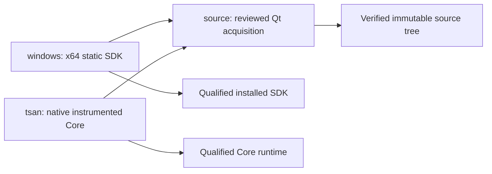

# Qt SDK tooling

All custom Qt SDK code lives here. The shared source provider owns acquisition and integrity; the two target recipes own compilation and output qualification. Player code and Qt Widgets bindings have their own runtime/frontend owners.

- [source](source/README.md): pins, URLs, transfer, checksum verification, extraction and source-cache receipts. `python3 -m scripts.qt.source VERSION WORKSPACE`.
- [windows](windows/README.md): x64 MinGW recipe, context and installed Qt Test qualification. `scripts/qt/windows/build.sh INSTALL_PREFIX [WORKSPACE]`.
- [tsan](tsan/README.md): compiler/host context, instrumented Core, atomic runtime receipts and actual consumer-loader verification. `python3 -m scripts.qt.tsan WORKSPACE`.

These are the canonical commands. There are no root build-qt launchers or duplicate Qt SDK implementations in tools. Both builders can share the explicit `WIOLA_QT_SOURCE_CACHE` workspace; there is one downloader and one reviewed release registry.

Each child owns its complete implementation, direct tests and guide. CI supplies temporary paths, cache transport and supported profiles. Generic configured-build support is consumed through its public API; it does not own Qt recipe policy. Run `python3 -m unittest discover -s scripts/qt -t . -p 'test_*.py'` for the complete Qt tooling contract suite.
