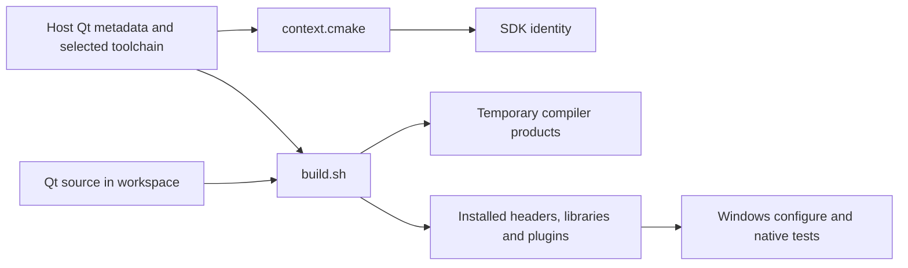

# x86-64 MinGW Qt SDK

`build.sh` builds the static Qt SDK consumed by the Windows preset. It owns the complete recipe, canonical command and validation. The recipe keeps the existing Qt module capabilities and includes Qt Test for native contract execution.

Call `scripts/qt/windows/build.sh INSTALL_PREFIX [WORKSPACE]`. One argument retains the existing `INSTALL_PREFIX/.work` behavior. Supplying a separate workspace keeps downloaded sources, CMake state and object files outside the SDK; CI caches only the install prefix. Paths with spaces are supported. The host prefix and CMake directory come from `qmake6`, rather than a fixed `/usr` or architecture guess. `WIOLA_QT_TOOLCHAIN_FILE` can select a toolchain file; the default is the repository's MinGW toolchain. The selected compiler must target `x86_64-w64-mingw32`; 32-bit and ARM targets are rejected.

`cmake -P scripts/qt/windows/context.cmake` writes a SHA-256 identity to stdout. It includes the host Qt version/location, compiler version and compiler target read from the selected toolchain. It has no GitHub dependency; CI combines the identity with the recipe/toolchain hash and runner platform. A failed build or missing Qt Test install cannot be reported as a completed SDK.

[Tests](tests/README.md) check workspace isolation, existing sources, legacy invocation, failed stages, identity changes and architecture rejection. Actual SDK compatibility is additionally qualified by configuring/linking the player and running its native Windows journeys.

Source acquisition belongs entirely to [the shared Qt source provider](../source/README.md).
The host version must have a reviewed checksum in its release registry. `WIOLA_QT_SOURCE_CACHE`
can select a shared source workspace. SDK context identity includes the selected source and
provider recipe, so source changes invalidate installed-SDK reuse. Python 3.12 is required by
the source provider; no Python package installation is needed for it.
