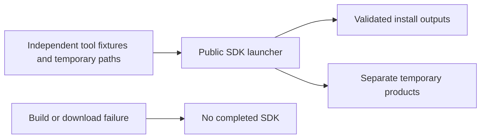

# SDK construction contracts

These process-level tests exercise the public launcher with isolated temporary directories and controlled external tools. They verify installed-output versus scratch separation, source reuse without network access, preserved one-argument behavior and rejection of failed/incomplete builds. The identity tests run the real CMake interpreter against a selected fixture compiler and verify invalidation by tool versions and rejection of non-x86-64 targets.

Run `python3 -m unittest discover -s scripts -t . -p 'test_*.py'`. No real Qt source download or SDK compilation is needed for these rejection paths. The CI Windows job supplies the real compiler/Qt integration qualification.

The shell/CMake recipe uses a controlled public source-provider process. Archive integrity,
transfer failure and safe extraction are independently tested by [the source owner](../../source/tests/README.md).
