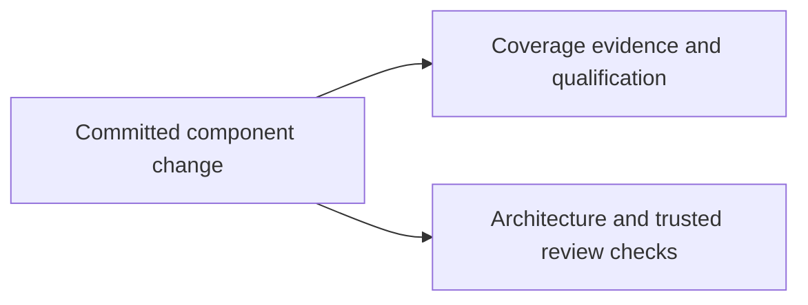

# Quality tooling

Quality tools qualify implemented behavior rather than select player features. Their complete implementation, tests, declarations and reader guides share one responsibility family.

[Coverage](coverage/README.md) owns raw collection, source applicability, reporting and workflow qualification. Architecture checks retain their current owner until the next complete family migration. These tools preserve historical identities and do not silently lower floors during reorganization.
