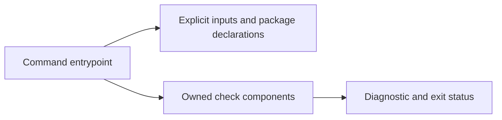

# Architecture command entrypoints

Commands assemble owned architecture abstractions and present outcomes. They do not implement registry or Git behavior. The current command is [check_ownership](check_ownership/README.md).

Player code never imports these development commands. Shared implementation belongs to a named component, not another command's main routine.

[Dependency checking](check_dependencies/README.md) assembles graph readers and policy checks. It consumes the contract catalog through its public API.

[Test-contract checking](check_tests/README.md) reconciles configured targets, CTest discovery and semantic test purposes without executing the suite.
