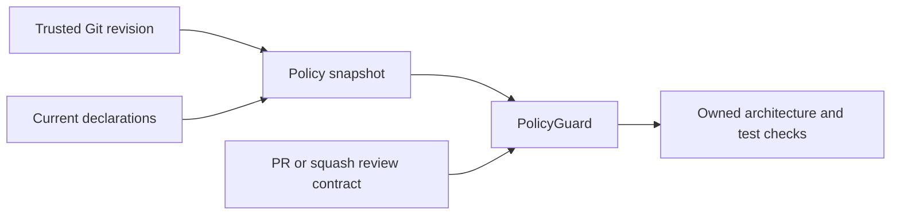

# Design acceptance command

This entrypoint assembles trusted policy comparison, review/naming validation and the existing ownership, dependency and source-applicability checks. With a configured build it also checks CMake ownership and prerequisites. Native test discovery is a separate opt-in operation.

In CI the event supplies a trusted base and PR review fields. Main uses the actual squash commit subject/body. Local review uses `--base-ref REF --review BODY_FILE --subject 'area: description'`; add `--build-dir PATH` for configured checks. Add `--test-discovery` only for an already-built, runnable native suite. Cross-compiled inventories remain inspectable without launching foreign executables; their process qualification runs on the target platform. Paths and revisions come through the Git adapter. The command never configures or builds.

Exit 0 means structural acceptance passed, 1 reports weakened policy, and 2 reports invalid inputs or failed subordinate checks. Semantic review remains necessary. Preserve the complete reviewed PR body in main's squash commit so a later audit can inspect the same change contract.
