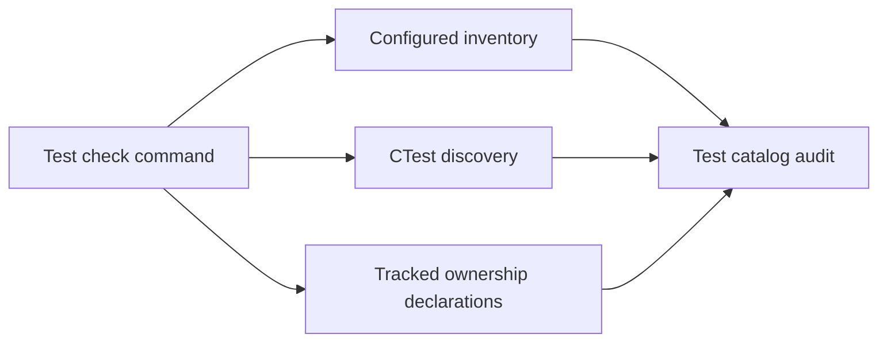

# Test-contract check command

Run `python3 -m scripts.quality.architecture.commands.check_tests --build-dir PATH` after configuring and building the tests. `--headless` selects the toolkit-free contract subset. The matching source root and target artifact paths come from CMake; the command does not guess a preset's build directory.

The command reconciles C++ cases, auxiliary runners and Python source purposes. It asks CTest for discovery only and never reruns the suite. Exit 0 accepts the inventory, 1 reports contract mismatches and 2 reports unusable input. Its public entrypoint only assembles independently owned components.
