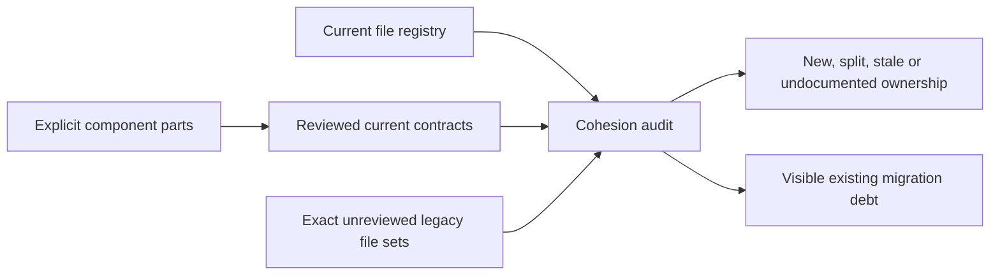

# Abstraction contracts

`ContractCatalog` checks an explicitly reviewed responsibility, invariants, public files and complete owning subtree against the file registry. One component can explicitly contain several stable inventory parts. This preserves source/measurement identity when related declarations and implementation belong together, without requiring another folder or API for every historical class/header ID.

The primary owner lists the component README. All declared parts stay within the same root; public files may belong to any of them. Every part belongs to at most one component, and reviewed parts leave the exact legacy allowance. An undeclared/unrelated owner remains forbidden inside the subtree. A grouping folder describes independent children rather than combining their implementations.

`definitions.py` describes reviewed **current** contracts. `AbstractionContract.parts` names additional inventory IDs forming the same component; `owner_ids` returns the immutable primary/part membership. Parts must share one declared module capability in dependency policy. Internal private access stays inside that reviewed component, while external callers use its public surface. Declaring membership never grants new module or Qt permissions.

The data file freezes still-unreviewed legacy owners by exact file-set digest. It is not an exemption for whole directories, a future plan, or approval of the old architecture. New ownership or changed file membership needs a reviewed contract. Remove every participating legacy record when adding that contract.

These checks prove explicit physical ownership and declared invariants, not that the invariant is semantically correct. Behavioral tests and review remain necessary; adding an unrelated class inside an existing file is not justified by an unchanged file-set digest. The final architecture must retire the legacy debt.

Run `python3 -m unittest scripts.quality.architecture.contracts.tests.test_catalog` for the [contracts](tests/README.md).

`load_current_catalog()` in the public `catalog.py` API loads the current definitions and exact legacy inventory. Consumers use the immutable `contracts` tuple instead of importing private definition or data files.
