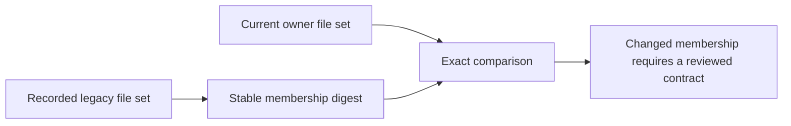

# Legacy ownership debt

The file-set digests identify existing owners whose complete architecture contract is not yet reviewed. The inventory remains explicit and their debt is reported; no new owner or changed membership can inherit the allowance.

Remove an allowance when its owner receives a reviewed current contract. These data describe current migration debt and contain no internal PR plan or proposed future source paths.
