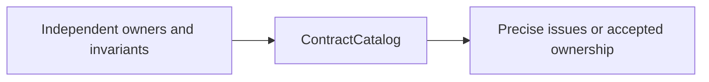

# Contract-catalog tests

Independent small registries demonstrate accepted cohesion, rejected split implementations, undeclared public headers, missing READMEs and unrelated owners inside an abstraction. A grouping-folder case proves legitimate parent/child ownership. Legacy cases prove exact membership and visible debt rather than a wildcard allowance.

The tests do not read the live legacy baseline, so the same data cannot manufacture both actual and expected acceptance.

Explicit-parts cases accept related values inside the component root without another README, preserve inventory identities and immutable membership, and reject missing/outside parts, duplicate membership, leftover legacy allowances and grouping misuse. A part cannot move the component guide away from its primary owner.

Test-member cases accept explicit colocated tests while rejecting runtime/external paths, public exposure, duplicate membership and grouping misuse. The associated dependency tests preserve their test-module restrictions; measurement tests prove their counts never enter production totals.
