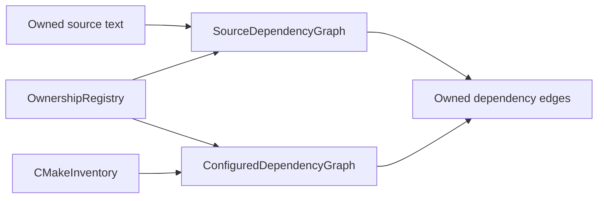

# Dependency observation

This component reads explicit C++ includes, Python imports and an existing CMake File API inventory. `graph.py` exports immutable edges carrying both owners. It never imports the inspected Python code, configures CMake or runs the player.

Source observation is a lexical include/import inventory, not a C++ preprocessor or dynamic Python resolver. CMake prerequisites include link and ordering dependencies; they are not presented as exact direct links. Qt compile definitions reveal configured transitive toolkit use. External targets absent from the codemodel remain outside this evidence. Public include aliases use the owning `public/` subtree. Tests cover relative/public includes, imports without execution, target prerequisites and transitive Qt usage.
