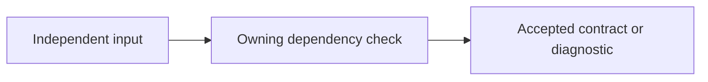

# Data

`modules.json` explicitly assigns current owners, dependency directions and Qt capability. `legacy.json` identifies exact current violations and their removal responsibility. Remove resolved entries; do not regenerate the baseline to accept a new violation.

