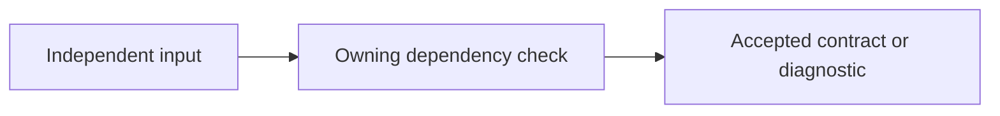

# Tests

Policy tests inject independent forbidden edges; passing the production inventory alone would not exercise rejection.

Related-part cases distinguish internal private access from an external private import, and reject overlapping/unassigned parts and cross-capability fusion. Source/destination membership failures remain explicit diagnostics.

Colocated-test cases permit access to the owning component's private implementation while rejecting production-to-test edges, external private access and test members assigned to runtime or missing modules.

