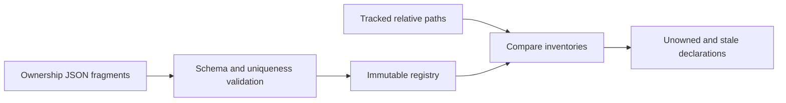

# Ownership registry

`OwnershipRegistry` validates the current one-owner-per-file inventory. It has no Git, CMake, Qt, filesystem traversal or product-runtime dependency. `Owner` and `InventoryDifference` are immutable values of this abstraction, not independent service implementations.

Invariants: an owner ID is stable and unique; a declared path is canonical, portable and repository-relative; every path has exactly one owner; duplicate JSON keys are rejected; unknown schema/fields fail explicitly. Comparison never turns an unowned file into an automatically accepted owner.

[Declarations](data/README.md) describe current code and include no future refactoring plan. Existing architectural debt remains visible in that code. [Tests](tests/README.md) prove rejection and comparison behavior. Callers provide JSON documents and tracked paths, so the inventory source and storage format boundary can be changed separately.
