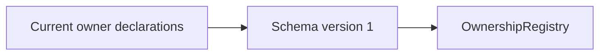

# Current ownership declarations

JSON fragments declare stable owner identities, current responsibilities and explicit tracked paths. Fragments are grouped for maintenance; they describe the current repository and contain no planned destinations or PR schedule. A path is present once across the complete registry.

The schema version belongs to the registry protocol. Every owner has `id`, `purpose` and a nonempty `files` list. An intentional move updates its existing identity; an added abstraction gets a distinct declaration. Update these data with the corresponding code change and run the ownership command. Do not add an exclusion just because a file is inconvenient to classify.
