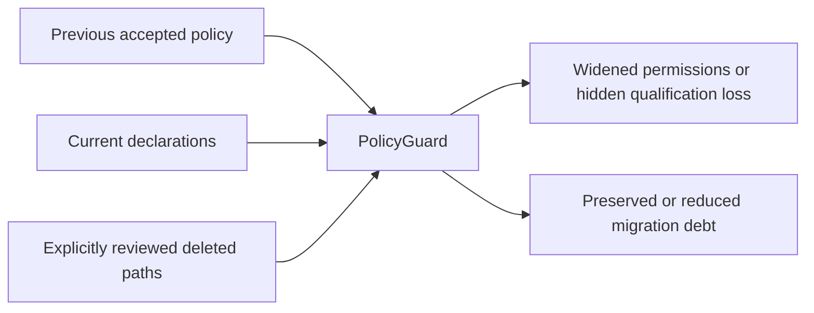

# Trusted architecture policy guard

`policy.py` exports immutable policy snapshots and `PolicyGuard`. It compares a proposed policy with previously accepted constraints; file loading and Git access belong to the command/adapter.

Legacy allowance growth/resets, new dependency exceptions, wider existing module permissions, Qt grants to portable modules, outward owner moves, removed semantic IDs and lost production/workflow applicability fail. A reviewed source move preserves identity and scope. An inward move follows an already allowed dependency direction, such as application to engine. True deletions need an explicit reviewed retirement; silent renames need lineage. Snapshot mappings do not alias caller-owned dictionaries.

This guard deliberately requires focused qualification work for broad policy changes rather than accepting blanket exceptions. It does not prove semantic coverage, correctness of prose or the sufficiency of current legacy contracts. [Tests](tests/README.md) independently seed weakening and cosmetic-move cases.
