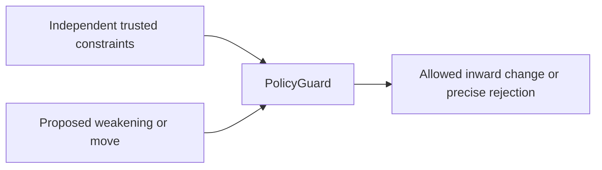

# Policy weakening regressions

These fixtures exercise debt growth/reset, widened dependencies, toolkit grants, inward versus outward ownership, source scope loss, removed required behaviors, explicit retirement and immutable trusted snapshots.

Run `python3 -m unittest discover -s tools -t . -p 'test_*.py'`. Passing the live repository alone would not exercise rejection.
