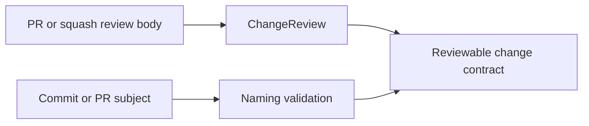

# Change-review contract

`review.py` exports `ChangeReview` and subject validation. It requires concrete responsibility, dependency, lifetime/error, removal and validation fields, alongside the repository's commit naming convention. It performs no Git or GitHub calls.

Comment-only placeholders, duplicate sections and missing fields fail. Published main subjects require the PR suffix. A deleted source is reviewed only when its actual path is named in backticks in the removal field. These structural checks do not establish that prose is truthful or an abstraction is elegant; those remain semantic review responsibilities.

[Tests](tests/README.md) use independent complete/incomplete review bodies and naming violations.
