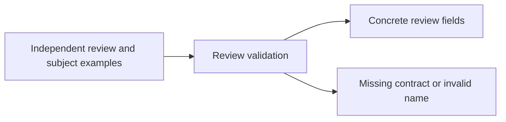

# Review contract tests

Fixtures check complete contracts, explicitly named retirements, missing/comment-only/duplicate fields and invalid published subjects. The expected naming convention is independent of the current Git history.

Run `python3 -m unittest discover -s tools -t . -p 'test_*.py'`.
