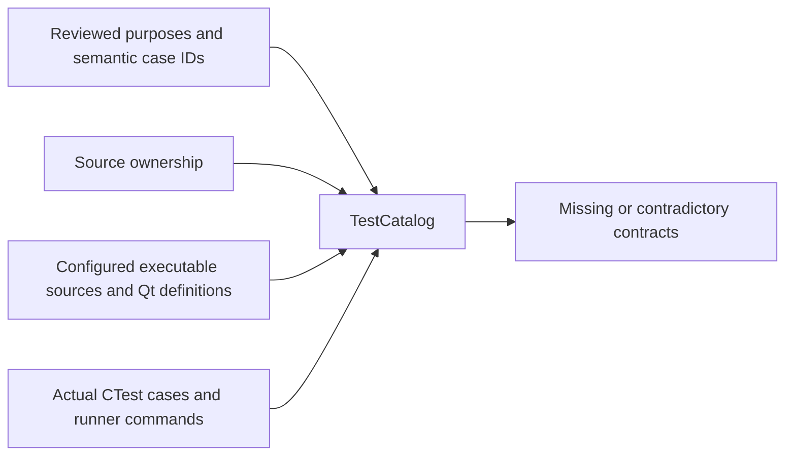

# Test catalog

`catalog.py` exports test contracts and reconciliation against CMake, CTest and file ownership. A test's semantic role is distinct from its current toolkit requirements: presentation/domain behavior does not become widget behavior because an aggregate library links Qt. Existing coupling is recorded explicitly; it is not evidence that Qt can already be removed.

[data](data/README.md) records current target membership, owners, roles and Qt requirements. Independent semantic requirement IDs select critical behavior witnesses, rather than asserting that whatever discovery returns is sufficient. Auxiliary script runners have owned source paths; Python tool tests have explicit owner records too. Catalog validation reports missing targets/cases, changed source ownership or toolkit applicability, and undeclared test commands. Standard `*_test.cpp` and `test_*.py` source membership is checked even when a source was accidentally omitted from discovery. It never executes C++ tests.

Run `cmake --build --preset YOUR_PRESET --target wiola_check_test_contracts` after building that preset's tests, or use [the command](../../architecture/commands/check_tests/README.md) with an explicit build directory. Headless selection excludes Qt-linked contracts; it does not pretend incidentally linked tests are already toolkit-free. [Tests](tests/README.md) exercise rejection using independent inventories.
