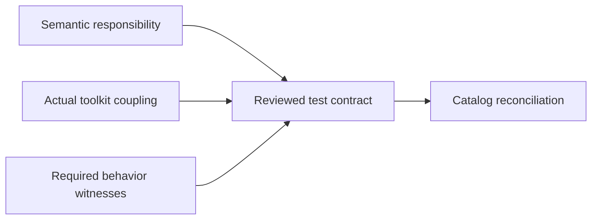

# Test purpose records

`targets.json` separates semantic roles from actual configured Qt linkage for current C++ test targets. Source files and stable source owners are explicit. `requirements.json` maps independent behavior IDs to case names and owns auxiliary runner declarations. `python.json` gives every maintained Python test source a tooling-contract owner.

Review metadata against assertions and source dependencies when moving/extracting a test. Rename a case by updating its witness mapping while retaining the semantic ID. Do not regenerate required cases from discovery, remove requirements to make missing tests pass, or describe an aggregate's incidental toolkit linkage as a business invariant. These files describe current tests, not future work plans.
