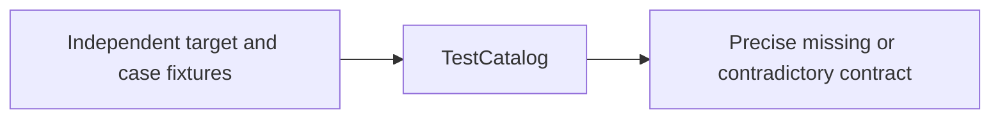

# Catalog rejection tests

Synthetic target/discovery inputs exercise accepted ownership, missing semantic cases, changed toolkit/source applicability, unknown commands, duplicate declarations, headless selection and auxiliary runner ownership. A live checkout passing reconciliation alone would not test these rejection paths.

Run with `python3 -m unittest scripts.quality.architecture.test_catalog.tests.test_catalog`. Temporary paths come from the test environment; no personal checkout or build location is required.

Owned Python runner cases cover script and package-module commands, exact arguments containing spaces, wrong or missing ownership, incorrect module identity, missing/duplicate cases and symlink escapes. A real temporary package executes from its own nonrepository root using the resolved command; resolution itself never executes source.
