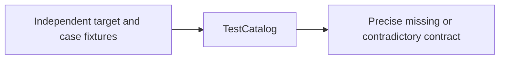

# Catalog rejection tests

Synthetic target/discovery inputs exercise accepted ownership, missing semantic cases, changed toolkit/source applicability, unknown commands, duplicate declarations, headless selection and auxiliary runner ownership. A live checkout passing reconciliation alone would not test these rejection paths.

Run with `python3 -m unittest discover -s tools -t . -p 'test_*.py'`. Temporary paths come from the test environment; no personal checkout or build location is required.
