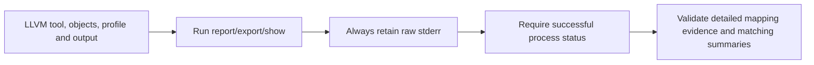

# LLVM reporting adapter

`LLVMReporter` owns report/export/render execution and raw stderr retention. `MappingDiagnostics` owns the strict agreement between detailed zero-hash mapping sentinels and later summary warnings. The collection entrypoint supplies its tool, objects, profile, output streams and phase; this adapter knows no build-tree layout or CI provider.

An aborted/nonzero LLVM process fails with its actual stderr and retained diagnostic path. Malformed, nonzero-hash, unaccounted or inconsistent warnings still fail; reporting failures never become empty successful reports or relaxed coverage floors. Detailed report evidence must precede export/show for each named phase. `diagnostics` returns a snapshot suitable for the collection manifest, not mutable internal state.

Files keep the existing `PHASE-OPERATION-mapping-diagnostics.txt` artifact naming contract so current CI diagnostic uploads retain failures as well as successful observations. No retry, silent fallback or profile regeneration happens here. The existing collector parser entrypoint delegates to the same owned diagnostic policy.

Detailed `report -dump` runs with one worker. LLVM's per-file debug reporting writes to a shared output stream from parallel workers, causing intermittent heap corruption; see [upstream issue208182](https://github.com/llvm/llvm-project/issues/208182). This policy belongs to the LLVM adapter rather than CI or collection scripts. Export/HTML commands keep normal parallelism. Inputs, mapped counts, strict detailed diagnostics and failure propagation are unchanged; no retry hides a failed report.
