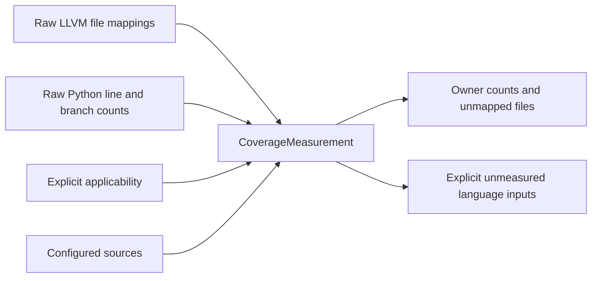

# Coverage normalization by owner

`report.py` exports `CoverageMeasurement`. It interprets LLVM and Coverage.py reports using the source policy and actual CMake inventory. It does not build or execute tests.

A configured production translation unit without a coverage mapping fails. Unmapped headers remain visible because a missing instantiation cannot be assumed covered or nonexecutable. Test mappings inside a production subtree are removed from production totals. Duplicate mappings, unowned first-party inputs, invalid counts and mismatched build roots fail. External files are outside the first-party scope. C++ lines/functions/regions/branches/instantiations and Python lines/branches use separate denominators; a zero denominator is not a 100% claim.

Run `python3 -m scripts.quality.coverage.measurement --cpp-report PATH --python-report PATH --build-dir PATH --output PATH`. [The baseline](baseline/README.md) records a qualified observation, and [tests](tests/README.md) exercise rejected and incomplete evidence. It is not a promise that all owners already meet the final coverage goal.

The legacy LLVM HTML summary still lists every mapped file selected by its collector, including colocated tests. Use this owner-normalized production report for project totals; raw mappings remain evidence rather than a completion badge.

Current normalized reports use schema version2 and retain LLVM function-instantiation counts separately from source-function counts, including distinct template variants, for each file, owner and total. A source function can be covered while a second explicit template instantiation remains uncalled; full line/function coverage does not erase that gap. Missing or invalid instantiation counts fail instead of becoming a zero denominator. Historical version1 observations and workflow floor files remain unchanged.

For an independent component, add `--component PATH` using the exact root of one reviewed complete contract, for example `src/core/media`. The contract's explicit owner membership and parts determine scope; path prefixes do not. Supply only the reports needed by that component's C++/Python sources. An omitted language is `null`, not a covered zero denominator. Groupings, unknown roots, unsupported-only components and missing required reports fail. Global invocation still requires both report inputs and keeps its existing result shape.

The Python API accepts `CoverageMeasurement(policy, root, owners=...)` for explicit owner analysis. Known unselected mappings are listed separately in scoped results. Unknown first-party mappings still fail against the full source policy; selected configured translation units still require mappings and unmapped selected headers remain visible. Unrelated configured targets, tools and unmeasured languages do not enter the component totals. Metadata-only contract parts remain in the component descriptor without being treated as executable sources.

This is source normalization, not a declaration of100% qualification. Zero-hit branches, uncalled instantiations and missing headers remain gaps. Raw compiler/profile integrity and exact component acceptance are separate evidence requirements.
