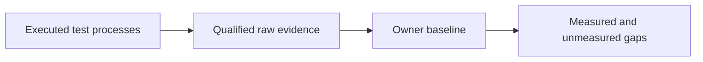

# Qualified owner baseline

`qualified.json` records an observed baseline with C++ and Python qualification kept separate. It retains raw owner counts, mapped/unmapped file identities and explicit unmeasured inputs. C++ evidence names its tested revision, toolchain, process count and source digest; Python evidence identifies the instrumented source bytes and coverage tool version.

This baseline is an observation, not a completion badge. Headers without mappings and languages without qualified instrumentation remain unresolved. Future measurements must preserve source identity through reviewed lineage and must not reset floors to hide a regression. Full raw reports and process profiles are runtime artifacts, not checked-in binaries. Do not combine metrics from different languages/platforms or substitute a workflow subtotal for this owner inventory.
