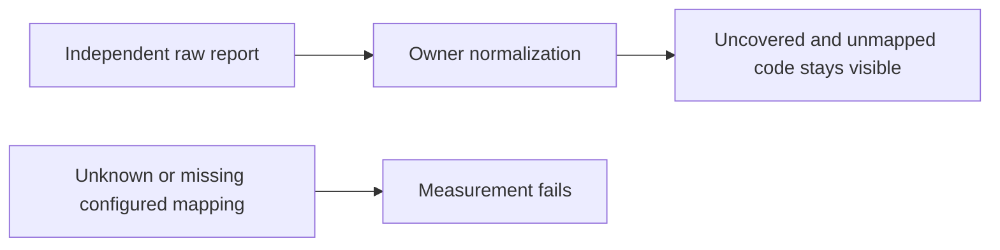

# Measurement rejection contracts

Synthetic reports independently verify template ownership, zero hits, source mappings, source/test separation within one owner, integer count validity, Python branch metrics and unmeasured tooling inputs. No external compiler or production report is needed to exercise rejection.

Run `python3 -m unittest scripts.quality.coverage.measurement.tests.test_report`. A live project report passing reconciliation does not replace these negative cases.

Independent LLVM summaries distinguish one fully covered source function from two template instantiations with one uncalled. Missing, negative, over-covered or boolean instantiation counts fail; per-file, owner and total counts must preserve the actual template gap.
