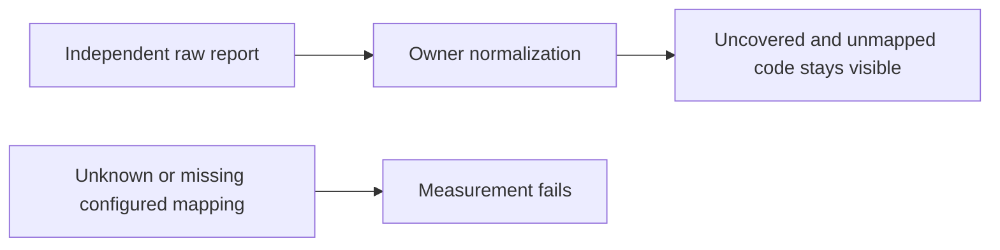

# Measurement rejection contracts

Synthetic reports independently verify template ownership, zero hits, source mappings, source/test separation within one owner, integer count validity, Python branch metrics and unmeasured tooling inputs. No external compiler or production report is needed to exercise rejection.

Run `python3 -m unittest discover -s tools -t . -p 'test_*.py'`. A live project report passing reconciliation does not replace these negative cases.
