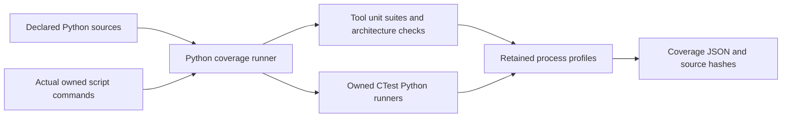

# Python instrumentation runner

This entrypoint measures maintained Python tools, their unit tests and owned Python script runners discovered in CTest. It uses the configured source/build inventory and retains separate process profiles; it never reruns the C++ suite.

Run with the interpreter that has the pinned Coverage.py dependency: `python3 -m scripts.quality.coverage.python_runner --build-dir PATH --output PATH`. The runner requires already configured/built tests for inventory checks and the installed-consumer script. Every command must succeed. The instrumented Python source hashes must remain stable during collection. Test-package discovery uses the repository top level so `scripts.quality.coverage` does not shadow the external `coverage` package. The manifest identifies completed commands, source bytes and profile hashes; the report does not invent function coverage for Python.

Auxiliary Python entrypoints come from the test catalog's public owned-runner resolver, shared with CTest auditing. Both declared script and package-module commands retain their original arguments. The collector never guesses script identity from a command position or dynamically imports a candidate module.

Both combination and JSON reporting retain original process profiles. Coverage.py reporting also combines parallel data; its explicit keep option is required even after a prior keep-enabled combine. Before reporting, require exactly one profile for every completed command plus the collector; afterwards, require the same filenames and byte hashes. An empty or mutated profile inventory cannot produce a qualified manifest. Earlier manifests produced by the deleting report step have empty profile inventories and do not prove retained raw-process provenance.
