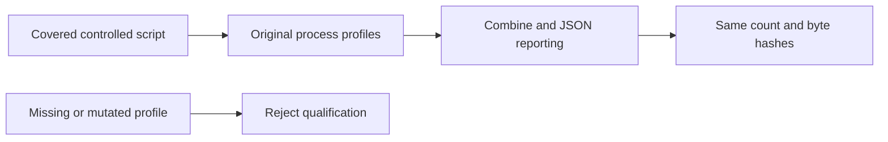

# Python profile retention tests

These contracts run the pinned Coverage.py against one independent temporary script and a real CMake File API context. They prove JSON reporting retains both the child and collector profiles with matching hashes. Missing command profiles and reporting-time mutation fail before a manifest can qualify.

Use the interpreter with requirements installed: `python3 -m unittest scripts.quality.coverage.python_runner.tests.test_profiles`. The fixture has no player identities or C++ suite. Full collector qualification additionally runs the actual owned script consumers.
