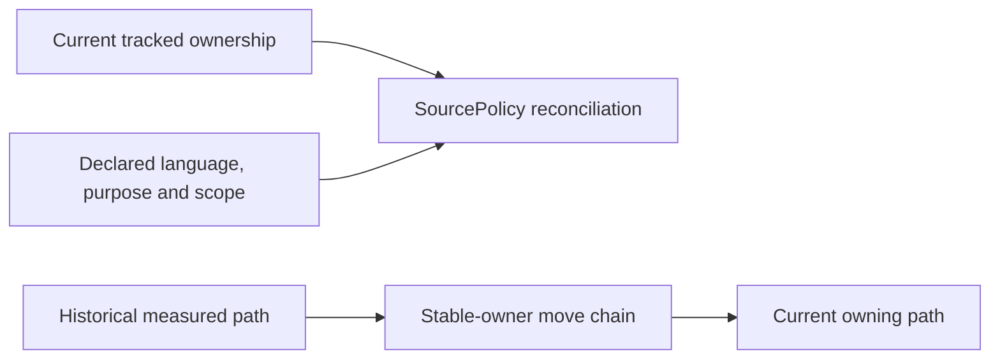

# Source applicability and lineage

`policy.py` exports explicit source records and one-to-one historical filename mappings. Ownership comes from reviewed declarations and is reconciled with the tracked registry. Runtime scope selection does not infer an architecture layer from a directory name.

Each executable-source input needs an owner, language and purpose. Test implementations remain test code even when colocated beneath a production owner. Workflow applicability and qualified test targets are explicit inputs, separate from whole-project measurement. A move retains its owner and scope and retires the old path. Cycles, merged identities and stale ownership fail. Migrating a report changes filenames only: every count and denominator is retained.

[data](data/README.md) stores current applicability and lineage; [tests](tests/README.md) seed missing owners, invalid scope, destructive moves and metric-preserving migration. Use `load_current_policy()` rather than reaching into private JSON storage.
