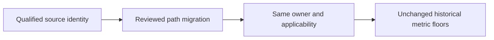

# Coverage applicability records

`sources.json` records current source language, purpose and qualified workflow applicability. Its explicit target set preserves the existing qualified workflow; the whole-project report measures every configured test target separately. `moves.json` starts empty and records reviewed one-to-one path migrations with stable owners.

Update records with source moves and additions. Do not relabel executable code as tests to improve a ratio, drop scope during a folder rename, or alter historical counts during migration. Source-language classification recognizes maintained C++, Python, shell, CMake and YAML inputs. Configuration data, documentation, generated outputs and external dependencies are not executable-source claims. Shell/CMake/YAML are listed as unmeasured until instrumentation is qualified; they do not silently contribute 100%.
