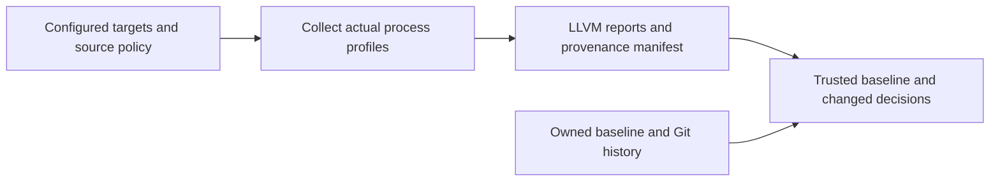

# Qualified LLVM workflow

This component owns reproducible collection and qualification of the existing workflow. Run `python3 -m scripts.quality.coverage.workflow.collect --help` for collection, and `python3 -m scripts.quality.coverage.workflow.gate --help` for exact-count floors and changed decisions. Executable tests and the unchanged qualified baseline belong here with their implementation.

Collection requires a committed source state and retained actual executable/profile identities. Shared input changes require fresh collection; refresh is limited to explicitly checked target-specific changes. External LLVM invocation and strict raw diagnostics belong to the sibling reporting component. The gate rejects missing mappings, reduced denominators, uncovered changed mapped decisions and incomplete process evidence; it never rounds partial coverage to 100%.

The baseline is the same historical observation after relocation. Trusted reads follow committed Git rename evidence and always read old contents from the trusted revision. Genuine new-policy bootstrap still requires the exact trusted tree. Build/report paths are caller inputs; the baseline default resolves beside this component rather than from a guessed checkout depth. Root shell launchers, file-import shims and sys.path mutation are retired. Historical owner IDs are explicit parts of this cohesive workflow, not competing components.
