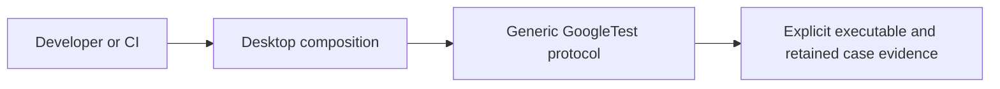

# Test execution tools

This family owns reusable test protocols and project-specific execution composition. Each component keeps its implementation, public API, focused tests and invariant guide together.

[GoogleTest](gtest/README.md) owns discovery, execution and exact report evidence without Qt, project identities or build layouts. Import its public API from `scripts.testing.gtest`. [Desktop composition](desktop/README.md) supplies only the project's fixture environment and caller-selected GUI adapter: `python3 -m scripts.testing.desktop --help`.

Environment changes are confined to child processes. Executable paths come from callers or configured build metadata, never guessed output directories. 

Installed public-package checks use CMake/CTest directly through `cmake/TestPublicPackage.cmake`; each component supplies its own C++ consumer. No Python package or JSON manifest is needed.
