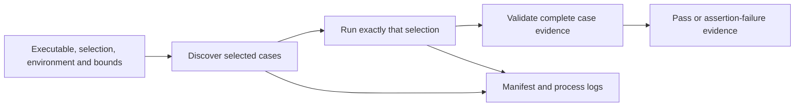

# GoogleTest execution protocol

Import the public protocol from `scripts.testing.gtest`; `_runner.py` and `_report.py` are private implementation. `GoogleTestRunner` discovers and executes an explicit selection against a caller-supplied executable. `GoogleTestReport` interprets case identities and assertion evidence; `GoogleTestResult` distinguishes a passing contract from an assertion-detected mutation. Together they own the GoogleTest protocol, without knowledge of Qt, Wiola case names, build-tree layouts or CI providers.

Every discovered selected case must appear exactly once and finish in the XML report. Skipped, absent, duplicate or contradictory case evidence cannot pass. An empty selection, discovery failure, timeout, malformed/missing XML or a binary that changes during execution fails closed. A stale report is deleted before discovery. Required case identities and positive selection/timeout bounds belong to the caller. Mutation detection requires GoogleTest's assertion-failure exit code and completed failing case evidence; a crash is never a detected regression.

Each invocation owns `manifest.json`, `discovery.log`, `execution.log` and `results.xml` in its explicit artifact directory. The manifest records executable digest, revision, selection and outcome. It does not dump inherited environment variables. The runner copies the caller environment and never changes global process state. Build-system target resolution, GUI environment setup and mutation source editing remain with their respective callers.
