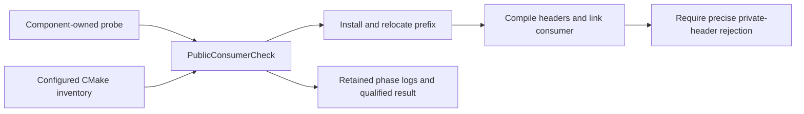

# Installed public-package qualification

This component owns one install, relocate, compile and link protocol. Import `PackageProbe` and `PublicConsumerCheck`, or run `python3 -m scripts.testing.public_api --help`. Component-owned manifests supply the package, imported target, install components, public header names, forbidden includes and a single consumer source. They contain no guessed build outputs or SDK paths.

The configured build must already contain the requested artifacts. The checker installs only declared components into an isolated temporary prefix, renames the prefix, and copies its CMake fixture and the consumer source into a workspace outside the checkout. It exposes no checkout include directory. Each public header compiles in its own translation unit. The positive executable must link before any negative probe is considered. Native execution is explicit; cross consumers are linked without running target executables. Compiler, system, optional toolchain and CMake executable are caller inputs.

Every forbidden include is compiled separately. A successful include fails qualification. A compiler failure qualifies only when the requested header has the precise missing-header diagnostic; syntax errors, linker errors, missing tools and timeouts cannot masquerade as privacy. No shell command or candidate module is dynamically executed to discover metadata. Configured artifacts and build execution use `scripts.build.cmake`.

The caller owns an empty evidence directory. Per-phase logs remain after failure, while temporary source/build/install directories are removed. Successful evidence also retains the consumer source and a qualification record. The CLI creates a distinct evidence run beneath the requested output directory. `register.cmake` composes the same command into CTest with the configured compiler/toolchain and explicit native-run applicability; it contains no component identities.

The component tests use independent temporary packages, including a deliberately leaked header and unrelated compiler failures. Borrowed references, quantities and media own their manifests and semantic consumers beside their implementation tests. Keep new component-specific API assertions there rather than adding player identities to this checker.
