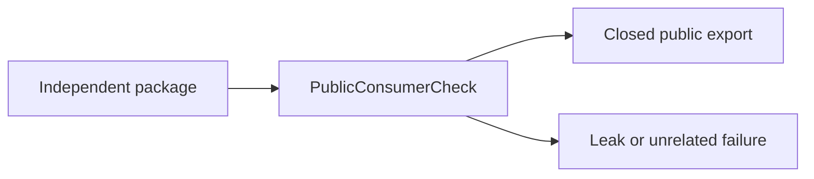

# Public consumer checker contracts

Controlled packages and configured CMake inventories exercise installation, relocation, individual-header compilation, positive linkage, precise private-include rejection and retained failure evidence. A leaked header and an unrelated syntax failure must both fail qualification. Inputs use temporary roots with spaces and no player target names.

Run `python3 -m unittest scripts.testing.public_api.tests.test_check`. Component CTest consumers exercise the same mechanism with the real Borrowed, quantities and media packages. Sanitizer and Windows consumers receive their configured compiler/toolchain through the shared registration function.

The real native consumer reports its working directory. It must differ from the caller directory, remain outside the source checkout, and be removed when qualification finishes. This protects against default profiling and scratch files leaking into the repository.
