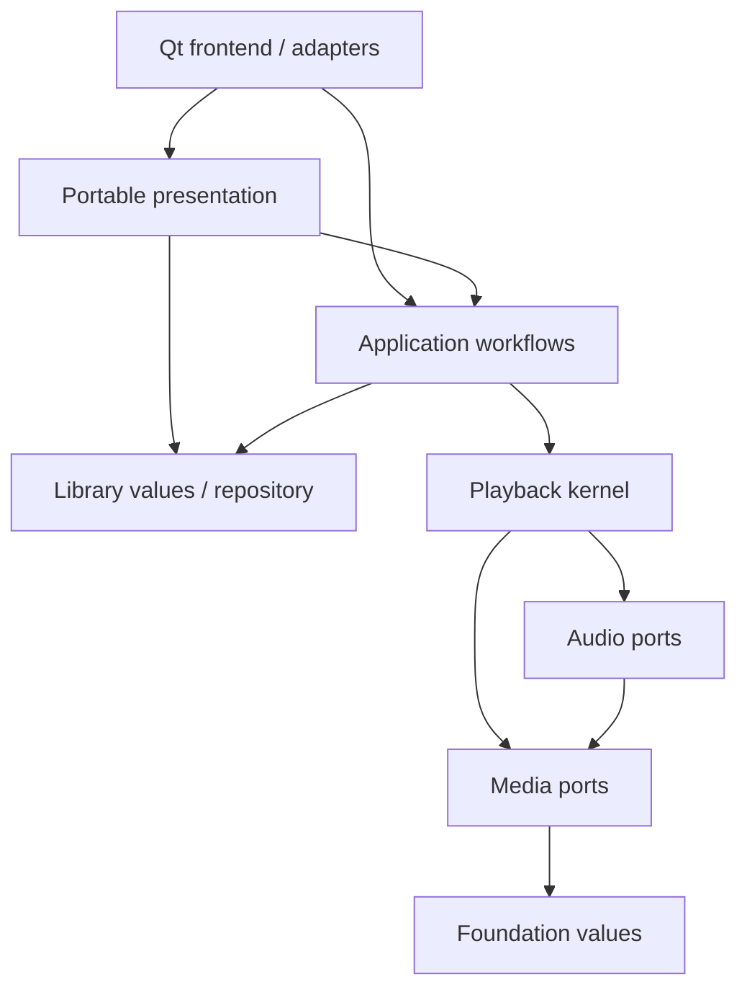

# Source owners

The tree groups code by responsibility. Kernel, driver, presentation and Qt owners keep their contracts, implementations, build definition and focused tests together. Application/library suites currently also live under the repository test root. SDK headers retain their namespaced includes through CMake exports; the source tree keeps declarations beside the code that implements them.

| Owner | Responsibility |
| --- | --- |
| [foundation](foundation/README.md) | Standard C++ ownership/capability and quantity values |
| [media](media/README.md) | Media/resource/decoder/byte-stream contracts and local/codec drivers |
| [audio](audio/README.md) | Render/output contracts, processing and the native device driver |
| [playback](playback/README.md) | Session, transport, queue, loading, metadata and pipeline lifetimes |
| [library](library/README.md) | Catalog identity, records, metadata, queries and repository rules |
| [app](app/README.md) | Player workflows that compose catalog and playback operations |
| [presentation](presentation/README.md) | Toolkit-independent row observations and view policy |
| [qt](qt/README.md) | Qt primitives, storage, application adapters, projection, widgets and entry point |

The host supplies media/output/processing collaborators through C++ ports. Concrete drivers stay with their subsystem. Qt types and event delivery stay in the Qt owner; portable clients can select the media/audio/playback components or build the headless presentation consumer. Existing source-level dependencies are declared by CMake targets, and installed consumers qualify the public SDK boundary.
