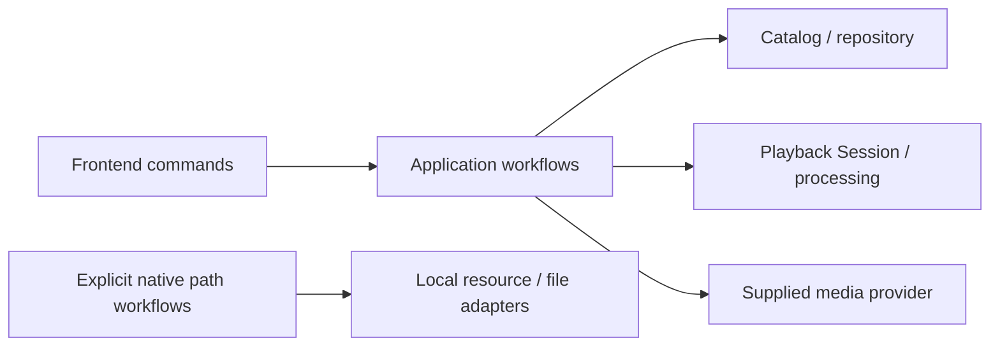

# Application workflows

This owner composes library and playback operations using standard C++ types. It contains catalog-derived indices, metadata/tag workflows, [playback commands](playback/README.md) and workspace discovery/reconciliation. Qt event-loop publication and window lifetime are supplied by the Qt application/frontend adapters.

PlaybackService owns its Session and built-in processing together. Metadata and workspace operations own their job/result values and cooperative contexts. Current local-file workflows compose resource references through the local adapter; the portable kernel receives those references through its existing ports.

The existing aggregate target is `wiola_app`; focused workflow cases currently live under [tests/app](../../tests/app). Their controlled collaborators test acceptance, failures and cancellation independently of widgets. QObject publication, QSettings, JSON persistence and concrete window composition live under [qt](../qt/README.md).
